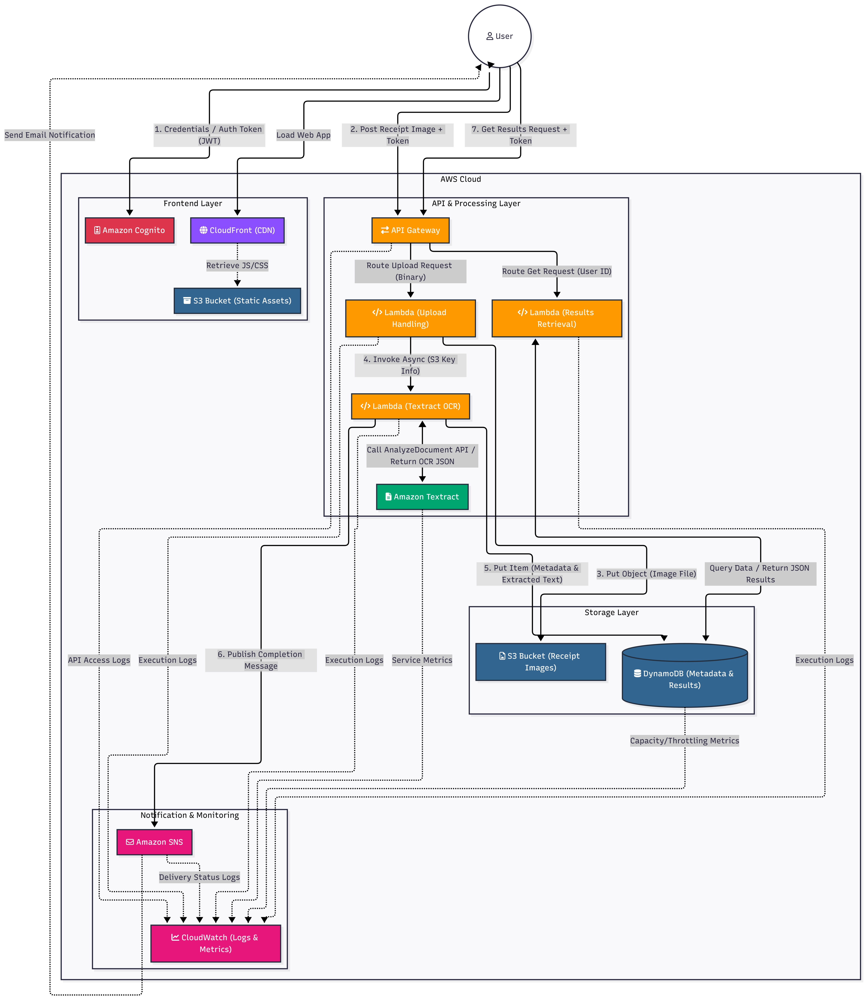
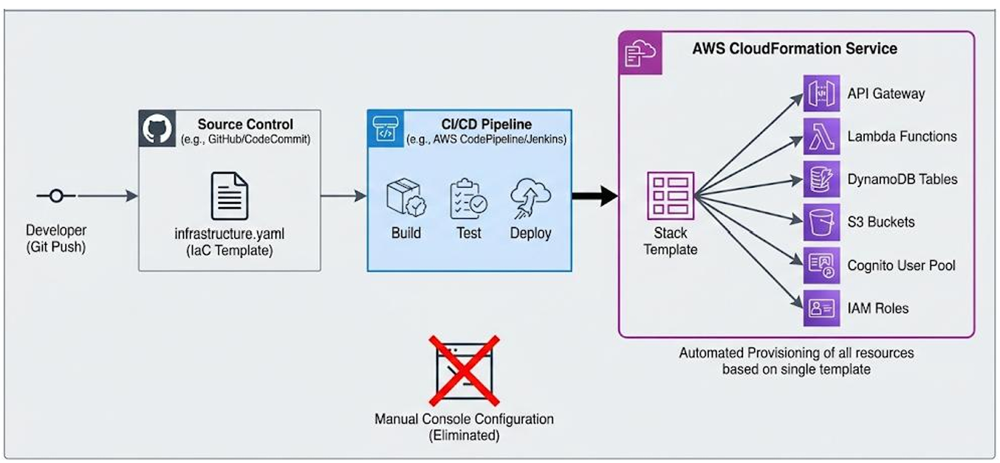
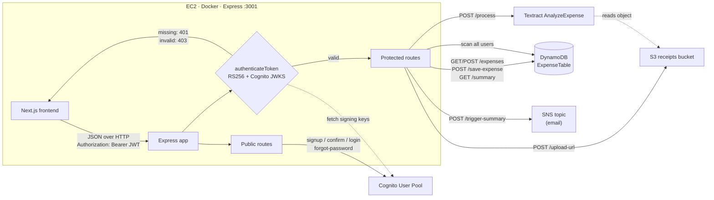
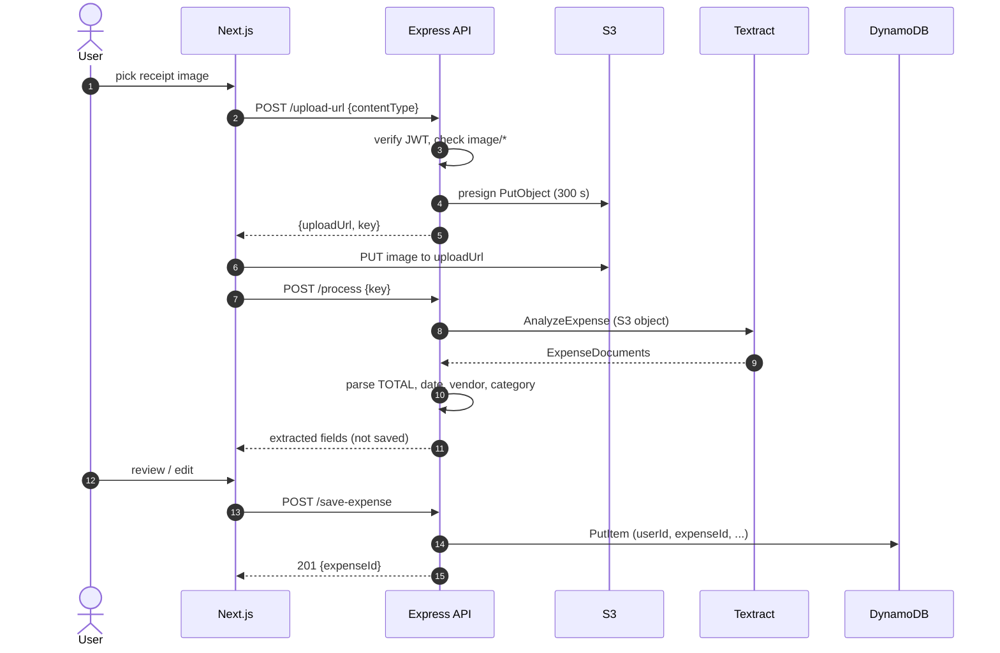
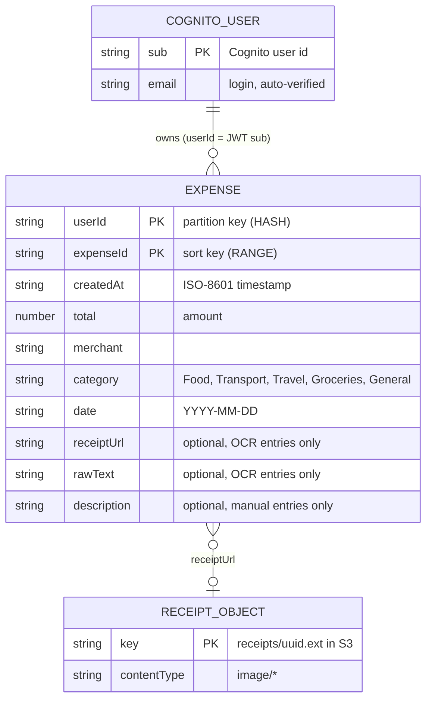
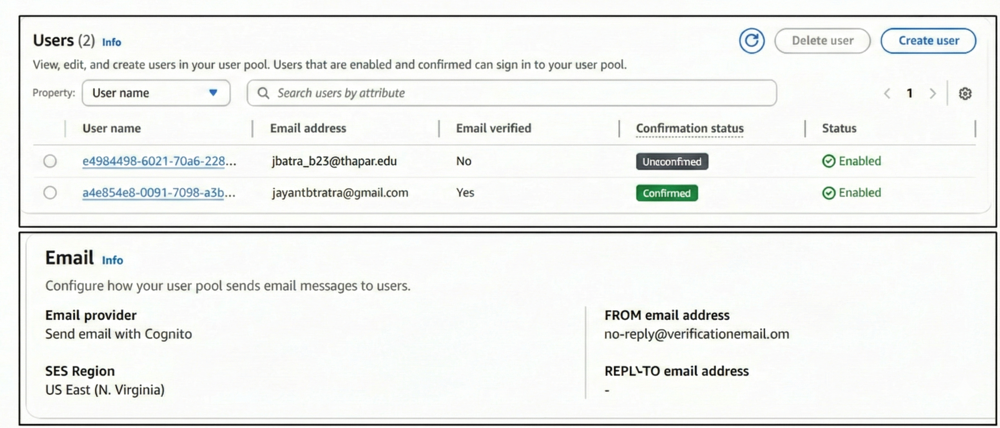
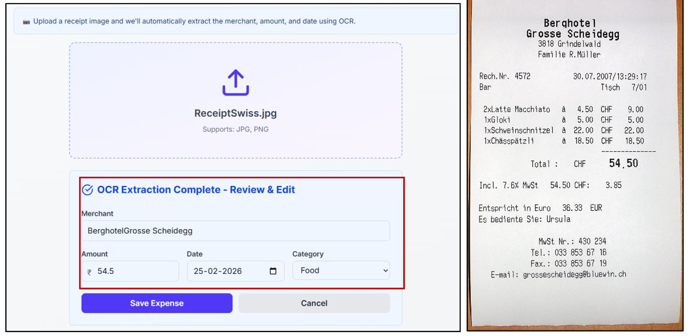
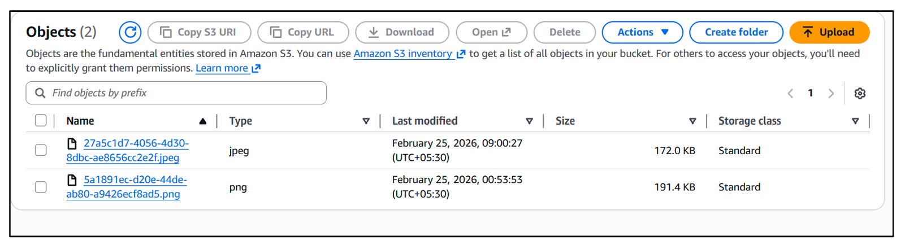

# AI-Powered Expense Tracker with OCR

Cloud-native expense management application built on AWS using managed AI services, Infrastructure as Code, and containerized deployment.

---

## Badges


---

## Table of Contents

* [Overview](#overview)
* [Problem Statement](#problem-statement)
* [Architecture](#architecture)
* [Tech Stack](#tech-stack)
* [Core Workflows](#core-workflows)
* [Infrastructure as Code](#infrastructure-as-code)
* [Containerization & Deployment](#containerization--deployment)
* [Security](#security)
* [Scalability](#scalability)
* [Testing](#testing)
* [Project Structure](#project-structure)
* [Setup & Deployment](#setup--deployment)
* [Future Enhancements](#future-enhancements)
* [Author](#author)

---

## Overview

The **AI-Powered Expense Tracker with OCR** is a production-ready cloud-native web application built on Amazon Web Services (AWS).

Users can:

* Authenticate securely
* Upload receipt images
* Automatically extract financial data using AWS Textract
* Visualize expenses through an interactive dashboard
* Receive automated monthly summaries via email

The project demonstrates real-world implementation of:

* Infrastructure as Code (IaC)
* Serverless storage
* Managed identity
* AI-as-a-Service
* Container orchestration
* Cloud-native architecture

---

## Problem Statement

Manual expense tracking requires repetitive data entry and often leads to errors.

This project automates receipt digitization using **AWS Textract AnalyzeExpense API**, reducing manual effort while maintaining scalability and security.

---

## Architecture

The system is designed using a layered cloud-native architecture.

### 1️⃣ Cloud Architecture (Component View)

* Client (Next.js frontend)
* EC2 (Dockerized backend & frontend)
* Cognito (Authentication)
* S3 (Receipt Storage)
* Textract (OCR)
* DynamoDB (Database)
* SNS (Notifications)
* VPC + Security Groups (Networking)



---

### 2️⃣ Data Flow Pipeline (Sequence View)

Workflows include:

* Authentication
* Receipt Upload + OCR Processing
* Expense Management
* Monthly Summary Notifications


---

### 3️⃣ Infrastructure Deployment (IaC View)

All AWS resources are provisioned through:

```
infrastructure.yaml
```



---

### 4️⃣ API Diagram

The backend is a single Express app (`backend/server.js`, container port `3001`). Public routes handle Cognito auth; every other route goes through `authenticateToken`, which verifies the Cognito-issued RS256 JWT against the user pool's JWKS and sets `req.user = { id: sub, email, username }`.



#### Endpoint reference

| Method | Path | Auth | Request | Response | Backed by |
| --- | --- | --- | --- | --- | --- |
| GET | `/health` | no | none | `200 {status:"ok"}` | Express |
| POST | `/auth/signup` | no | `{email, password, username}` | Cognito result | Cognito `SignUp` |
| POST | `/auth/confirm` | no | `{email, confirmationCode}` | Cognito result | Cognito `ConfirmSignUp` |
| POST | `/auth/login` | no | `{email, password}` | tokens | Cognito `InitiateAuth`, falls back to `AdminInitiateAuth` |
| POST | `/auth/forgot-password` | no | `{email}` | Cognito result | Cognito `ForgotPassword` |
| POST | `/auth/confirm-forgot-password` | no | `{email, code, newPassword}` | Cognito result | Cognito `ConfirmForgotPassword` |
| POST | `/upload-url` | JWT | `{contentType, filename?}` (image types only) | `{uploadUrl, key}` | S3 presigned `PUT`, expires in 300 s, key `receipts/<uuid>.<ext>` |
| POST | `/process` | JWT | `{key}` | `{extracted:{merchant,total,date,category,rawText}, receiptUrl}`. Nothing is saved. | Textract `AnalyzeExpense` |
| POST | `/save-expense` | JWT | `{merchant, total, date, category?, receiptUrl?, rawText?}` | `201 {expenseId, expense}` | DynamoDB `PutItem` |
| POST | `/expenses` | JWT | `{amount, merchant, category, description?, date?}` | `201 {expenseId}` | DynamoDB `PutItem` (manual entry) |
| GET | `/expenses` | JWT | none | `{expenses:[...]}` for the caller | DynamoDB `Query` on `userId` |
| GET | `/summary?month=YYYY-MM` | JWT | query `month` | `{month,totalAmount,count,categoryBreakdown}` | DynamoDB `Query`, aggregated in the app |
| POST | `/trigger-summary` | JWT | none | `{message}` | DynamoDB `Scan` + SNS `Publish` |

Status codes used: `400` validation, `401` no token, `403` bad token, `201` created, `500` unexpected.

#### Receipt flow, call by call



---

### 5️⃣ Database Schema

Data is stored in a single DynamoDB table, `ExpenseTable`, defined in `backend/infrastructure.yaml`. Users are not stored in the app: identity lives in the Cognito user pool, and the JWT `sub` claim is the `userId` partition key.



#### Table definition

| Property | Value |
| --- | --- |
| Table | `ExpenseTable` (CloudFormation `AWS::DynamoDB::Table`) |
| Partition key | `userId` (S), the Cognito `sub` |
| Sort key | `expenseId` (S) |
| Billing | `PAY_PER_REQUEST` |
| Secondary indexes | none |

#### Attributes

| Attribute | Type | Required | Notes |
| --- | --- | --- | --- |
| `userId` | S | yes | Cognito `sub` from the verified JWT, never taken from the request body |
| `expenseId` | S | yes | OCR/`/save-expense` entries: `<ISO timestamp>-<uuid>` (sorts by time). Manual `/expenses` entries: plain `<uuid>` |
| `createdAt` | S | yes | ISO-8601 |
| `total` | N | yes | Parsed with `parseFloat` |
| `merchant` | S | yes | Textract `VENDOR_NAME`, default `Unknown` |
| `category` | S | yes | Keyword rules in `utils/parser.js`, default `General` |
| `date` | S | yes | `YYYY-MM-DD`, falls back to today if Textract finds none |
| `receiptUrl` | S | no | Set for OCR entries only |
| `rawText` | S | no | Concatenated Textract summary fields |
| `description` | S | no | Manual entries only |

Example item:

```json
{
  "userId": "b4a8e4c8-1001-70f3-...",
  "expenseId": "2025-11-21T09:14:02.511Z-3f6c1f0e-...",
  "createdAt": "2025-11-21T09:14:02.511Z",
  "merchant": "Burger Point",
  "total": 18.5,
  "category": "Food",
  "date": "2025-11-21",
  "receiptUrl": "https://<bucket>.s3.amazonaws.com/receipts/9d1e....jpg",
  "rawText": "Burger Point 18.50 11/21/2025"
}
```

#### Access patterns

| Need | Operation | Cost |
| --- | --- | --- |
| All expenses for a user | `Query userId = :id` | One partition, cheap |
| Monthly summary for one user | `Query` by user, then filter `date` in the app | Reads all of the user's items |
| Monthly email for all users | `Scan` | Reads the whole table |
| Expenses in a date range, by category | not supported without a GSI (`userId` + `date`) | Would need a new index |

#### Related storage

| Store | Layout |
| --- | --- |
| S3 `expense-tracker-receipts-<account>-<region>` | Objects under `receipts/<uuid>.<ext>`. Uploaded directly by the browser through a presigned `PUT`. |
| SNS topic `monthly-expense-summary` | Plain-text monthly summaries, delivered by email subscription. |
| Cognito user pool `expense-tracker-users` | Email as username, auto-verified email, password rule: 8+ chars, upper, lower, number. |

---

## Tech Stack

### Frontend

* Next.js 16
* TypeScript
* Tailwind CSS

### Backend

* Node.js v22
* Express.js

### Containerization

* Docker
* Docker Compose

### AWS Services

* EC2 (t3.micro)
* Cognito
* S3 (Presigned URLs)
* Textract (AnalyzeExpense API)
* DynamoDB (Pay-per-request)
* SNS
* CloudFormation
* VPC & Security Groups

---

## Core Workflows

### Authentication Flow

* User signup with email verification (OTP)
* Cognito password auth (the backend calls `InitiateAuth` / `AdminInitiateAuth`)
* JWT token issued upon login
* JWT used for protected API calls




---

### Receipt Upload & OCR Pipeline

1. User selects receipt
2. Backend generates presigned S3 URL
3. Frontend uploads directly to S3
4. Backend calls Textract AnalyzeExpense
5. Extracted fields returned:

   * Merchant Name
   * Total Amount
   * Date
6. User confirms data
7. Expense saved to DynamoDB




---

### Expense Dashboard

* JWT-authenticated requests
* Partitioned DynamoDB queries using `userId`
* Displays:

  * Category pie chart
  * Monthly trend line chart
  * Expense table
  * Summary statistics


---

### Monthly Email Notifications

* Aggregation of last month's expenses, started on demand via `POST /trigger-summary` (a scheduler is planned, see Known Limitations)
* Formatted HTML summary
* Published to SNS topic
* Delivered via email




---

## Infrastructure as Code

All AWS resources are defined in a single declarative file:

```
infrastructure.yaml
```

Resources created:

* VPC
* Public Subnet
* Internet Gateway
* Route Tables
* Security Groups
* EC2 Instance
* IAM Role & Instance Profile
* Cognito User Pool & Client
* S3 Bucket
* DynamoDB Table
* SNS Topic

### Benefits

* Reproducible deployments
* Version-controlled infrastructure
* Automated rollback
* No manual console configuration

---

## Containerization & Deployment

Two containers:

| Service  | Port |
| -------- | ---- |
| Backend  | 3001 |
| Frontend | 3000 |

Managed via `docker-compose`.

Benefits:

* Environment consistency
* Dependency isolation
* Simplified deployment
* Production-ready setup

---

## Security

### Authentication

* JWT-based stateless authentication
* Cognito-issued RS256 JWTs, verified against the user pool JWKS
* Email verification
* Token expiration

### Data Protection

* Receipts reach S3 only through short-lived presigned `PUT` URLs (see Known Limitations on `bucket-policy.json`)
* 5-minute presigned URL expiration
* DynamoDB encryption at rest
* HTTPS enforced

### Network Isolation

* Custom VPC
* Restricted security groups
* Least-privilege IAM roles

---

## Scalability

### Current Limitation

* Single EC2 instance (Single Point of Failure)

### Future Improvements

* Application Load Balancer
* Auto Scaling Group
* CloudFront CDN
* ElastiCache (Redis)
* Lambda-based backend
* DynamoDB GSIs

---

## Testing

### Functional Testing

* Signup & OTP verification
* JWT validation
* OCR extraction accuracy
* Expense persistence

### Security Testing

* Unauthorized API rejection
* Expired token handling
* Cross-user isolation
* Presigned URL expiration validation

---

## Project Structure

```
.
├── backend/
├── frontend/
├── infrastructure.yaml
├── docker-compose.yml
└── README.md
```

---

## Setup & Deployment

### 1. Clone Repository

```bash
git clone <repository-url>
cd expense-tracker
```

### 2. Deploy Infrastructure

```bash
aws cloudformation deploy \
  --template-file infrastructure.yaml \
  --stack-name expense-tracker-stack
```

### 3. Run Application

```bash
docker-compose up --build
```

---

## Design Decisions

| Decision | Why | Trade-off |
| --- | --- | --- |
| DynamoDB with `userId` partition key and `expenseId` sort key | The main access pattern is "all expenses for one user". One `Query` on one partition, no joins needed, on-demand billing suits low traffic. | Other queries (by date range or category across users) need a GSI or a scan. |
| Cognito for identity, no user table | Managed signup, email verification, password reset and token issuing. The JWT `sub` becomes `userId`. | Auth is tied to AWS; the backend still proxies passwords through `AdminInitiateAuth` instead of using SRP in the browser. |
| JWT verified against the Cognito JWKS (RS256) | Stateless verification on every request, with no secret shared between services. | Tokens can't be revoked before expiry. |
| Presigned S3 `PUT` for uploads | The image goes browser to S3 directly, so the Node server never handles file bytes. Short expiry (300 s). | The key must be passed back to `/process`; the server has to check who owns it. |
| Two-step OCR (`/process`, then `/save-expense`) | Textract output is imperfect, so the user reviews and edits before anything is stored. | Two round trips. |
| Textract `AnalyzeExpense` over generic OCR | Returns structured fields (`TOTAL`, `VENDOR_NAME`, date) instead of raw text to parse. | Pay per page; category is still guessed with keyword rules. |
| Single EC2 instance with Docker Compose | Cheapest setup for a demo. | Single point of failure (see Scalability). |

---

## Known Limitations

Found while documenting the API and schema. Listed here so they are tracked, not hidden.

* **Public-read policy file:** `backend/bucket-policy.json` grants `s3:GetObject` to everyone. Don't apply it; reads should use presigned `GET` URLs.
* **No scheduler for monthly emails:** nothing in `infrastructure.yaml` triggers `/trigger-summary` (an EventBridge schedule is needed), and it uses a full-table `Scan`.
* **Summary privacy:** all users' summaries are published to one SNS topic, so every subscriber receives every summary. Needs per-user delivery (SES, or one topic per user).
* **`GET /summary` total:** it sums `amount`, but items store `total`, so `totalAmount` returns 0.
* **Inconsistent `expenseId`:** `/save-expense` writes `<timestamp>-<uuid>`, `/expenses` writes a plain uuid, so manual entries don't sort by time.
* **`/process` ownership check:** any authenticated user can run OCR on any S3 key. Prefix keys with the user id (`receipts/<userId>/...`) and check it.
* **No pagination:** `Query` returns at most 1 MB per call; `LastEvaluatedKey` is not followed.
* **Login flow:** `InitiateAuth` with `USER_PASSWORD_AUTH` is attempted first, but the user pool client does not enable it, so it falls back to `AdminInitiateAuth`.
* **Unused handlers:** `getExpenses.js` and `getMonthlySummary.js` (Lambda-style) are not wired into `server.js`.
* **Config in compose:** AWS account, Cognito and table identifiers are hard-coded in `docker-compose.yml`; move them to `.env`.

---

## Future Enhancements

* Multi-currency support
* Budget alerts
* Expense sharing between users
* Analytics export (CSV/PDF)
* Serverless backend migration
